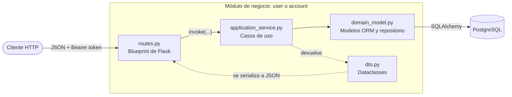
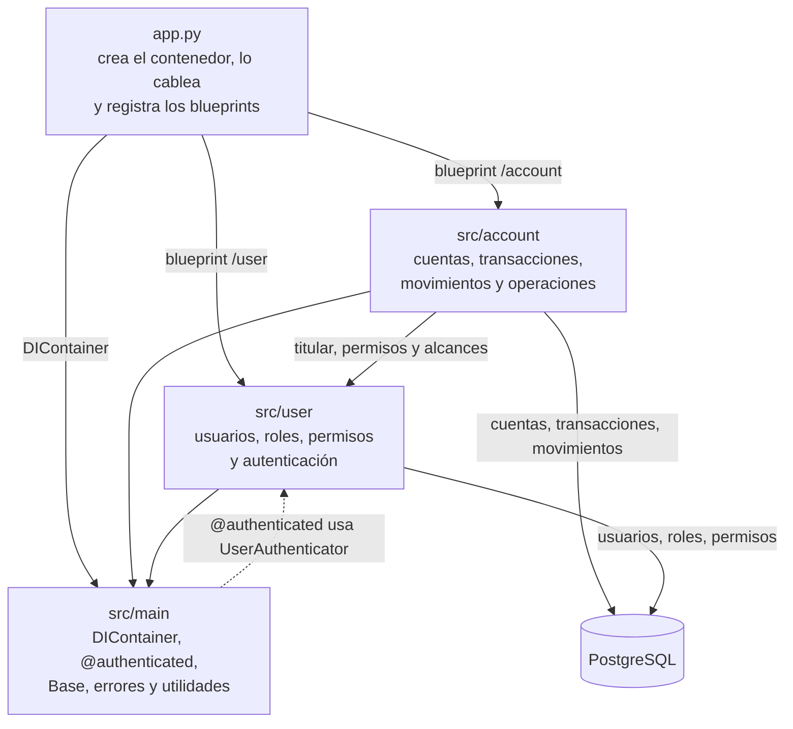
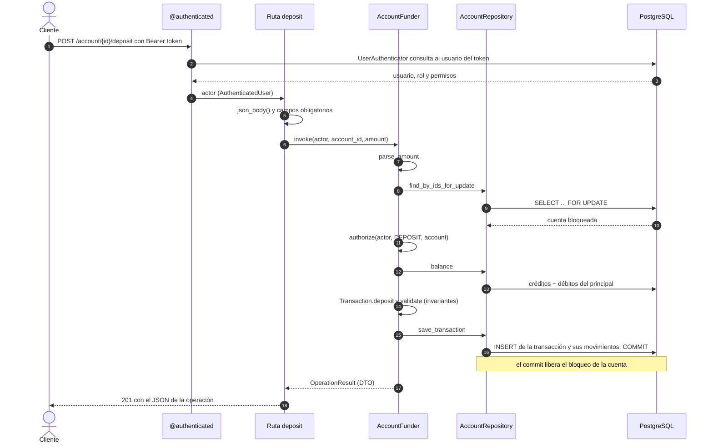

# Core bancario

Core bancario mínimo que registra cuentas y movimientos de dinero bajo la **ley de partida doble**, solo en pesos mexicanos (MXN). Ningún saldo se guarda ni se modifica directamente: todo cambio ocurre mediante movimientos balanceados, y el saldo de una cuenta se calcula a partir de ellos.

La especificación completa está en [`especificacion-core-bancario.md`](especificacion-core-bancario.md). Las referencias `§N` de este documento apuntan a sus secciones.

## Contenido

- [Funcionalidades](#funcionalidades)
- [Stack](#stack)
- [Puesta en marcha](#puesta-en-marcha)
- [Arquitectura](#arquitectura)
- [Modelo contable](#modelo-contable)
- [Usuarios, roles y permisos](#usuarios-roles-y-permisos)
- [Endpoints](#endpoints)
- [Servicios de aplicación](#servicios-de-aplicación)
- [Modelo de datos](#modelo-de-datos)
- [Concurrencia](#concurrencia)
- [Ejemplo de punta a punta](#ejemplo-de-punta-a-punta)
- [Pendientes](#pendientes)
- [Licencia](#licencia)

## Funcionalidades

- **Usuarios y acceso:** login con JWT, cambio de contraseña obligatorio en el primer ingreso, perfil del usuario autenticado, alta de administradores y operadores, y desactivación de usuarios.
- **Control de acceso por permisos (RBAC):** tres roles fijos (`CLIENT`, `OPERATOR`, `ADMIN`), cada uno con permisos de la forma *(acción, alcance)*.
- **Apertura de cuentas:** alta de cliente con su primera cuenta, cuentas adicionales para un cliente existente y cuentas propias del banco.
- **Operaciones:** fondeo, retiro y transferencia entre cuentas del mismo banco, cada una como una transacción atómica de partida doble.
- **Reversos:** un admin deshace un fondeo, un retiro o una transferencia con una transacción nueva que referencia a la original.
- **Consulta de saldo e historial:** lista de movimientos de una cuenta con el saldo que dejó cada uno, calculado en SQL por una vista.
- **Invariantes contables:** validadas en el dominio antes de persistir cualquier transacción.
- **Concurrencia segura:** bloqueo de filas para que dos operaciones simultáneas no gasten el mismo saldo.

## Stack

| Componente | Tecnología |
|---|---|
| Lenguaje | Python |
| Framework web | Flask 3.1 |
| ORM | SQLAlchemy 2.1 |
| Base de datos | PostgreSQL 17 en Docker (se requiere 15+ por `UNIQUE NULLS NOT DISTINCT`) |
| Driver | psycopg 3 |
| Autenticación | PyJWT (HS256) y bcrypt |
| Inyección de dependencias | dependency-injector |
| Configuración | python-dotenv |

Las versiones exactas están fijadas en `requirements.txt`.

## Puesta en marcha

```bash
# 1. Variables de entorno
cp .env.example .env            # y ajustar los valores

# 2. Dependencias
python -m venv venv
venv/bin/pip install -r requirements.txt

# 3. Base de datos
docker compose up -d

# 4. Esquema, roles, permisos y primer admin
venv/bin/python create_admin.py

# 5. Servidor de desarrollo en http://localhost:8080 (o el puerto de PORT)
venv/bin/python app.py
```

> **`create_admin.py` es destructivo:** borra y recrea todas las tablas y la vista `account_history`. Hoy es la única forma de crear el esquema, porque todavía no hay migraciones.

### Variables de entorno

| Variable | Uso |
|---|---|
| `POSTGRES_USER`, `POSTGRES_PASSWORD`, `POSTGRES_DB`, `POSTGRES_PORT` | Contenedor de `docker-compose.yml` |
| `DATABASE_URL` | Cadena de conexión de SQLAlchemy (`postgresql+psycopg://...`) |
| `JWT_SECRET` | Clave de firma HS256 |
| `JWT_EXPIRATION_MINUTES` | Duración del access token, 20 por defecto |
| `PORT` | Puerto del servidor de desarrollo, 8080 por defecto |
| `BANK_NAME` | Titular que se muestra en las cuentas NOSTRO |
| `ADMIN_EMAIL`, `ADMIN_PASSWORD` | Primer admin que crea `create_admin.py` |

`.env` no se versiona.

## Arquitectura

El código se organiza por **módulos de negocio**. Cada módulo tiene cuatro archivos, uno por responsabilidad, y las dependencias apuntan hacia el dominio:



Los módulos se apoyan en `src/main`, que es compartido, y `account` depende de `user` (titulares, permisos y alcances); `user` no conoce a `account`. La única dependencia en sentido contrario es la de `@authenticated`, que vive en `src/main` y usa el `UserAuthenticator` de `user`:



```
app.py                       # crea el contenedor, lo cablea y registra los blueprints
create_admin.py              # esquema + semilla RBAC + primer admin
docker-compose.yml           # PostgreSQL
src/
├── main/                    # compartido por todos los módulos
│   ├── container.py         # DIContainer: engine, sesiones, repositorios y servicios
│   ├── database.py          # Base declarativa de SQLAlchemy
│   ├── errors.py            # AuthenticationError (401), PermissionDenied (403)
│   ├── middleware.py        # decorador @authenticated
│   ├── routes.py            # GET / y manejadores de error globales
│   └── utils.py             # bcrypt, JWT, bearer_token(), json_body()
├── user/                    # usuarios, roles, permisos y autenticación
│   ├── domain_model.py
│   ├── dto.py
│   ├── application_service.py
│   └── routes.py
└── account/                 # cuentas, transacciones, movimientos y operaciones
    ├── domain_model.py
    ├── dto.py
    ├── application_service.py
    └── routes.py
```

| Archivo | Responsabilidad |
|---|---|
| `routes.py` | Blueprint de Flask. Lee y valida la forma del cuerpo, llama a un servicio y serializa la respuesta. No contiene reglas de negocio. |
| `application_service.py` | Casos de uso. Cada servicio es una clase con un único método `invoke(...)`: autoriza, coordina el dominio y el repositorio, y devuelve un DTO. |
| `domain_model.py` | Enums, modelos ORM con sus reglas (movimientos, invariantes, alcance de una cuenta) y el repositorio del módulo. |
| `dto.py` | Dataclasses que cruzan entre rutas y servicios. Ningún modelo ORM sale de un servicio. |

> La especificación (§3) propone una carpeta por capa dentro de cada módulo. El código usa archivos planos por módulo, con el modelo ORM y su repositorio juntos en `domain_model.py`.

### Inyección de dependencias

`DIContainer` (`src/main/container.py`) declara el engine como `Singleton` y las sesiones, repositorios y servicios como `Factory`. Cada repositorio recibe su propia sesión. Las rutas reciben el servicio que necesitan:

```python
@blueprint.route("/<uuid:account_id>/deposit", methods=["POST"])
@authenticated()
@inject
def deposit(
  account_id: UUID,
  actor: AuthenticatedUser,
  account_funder: AccountFunder = Provide[DIContainer.account_funder]
):
  ...
```

### Ciclo de una solicitud

1. `@authenticated()` toma el token del header `Authorization`, lo valida con `UserAuthenticator` y pasa el usuario a la ruta como `actor`.
2. La ruta lee el cuerpo con `json_body()` y revisa que estén los campos obligatorios.
3. El servicio de aplicación exige el permiso, ejecuta el caso de uso y devuelve un DTO.
4. La ruta convierte el DTO a JSON.

El mismo ciclo en un fondeo (`POST /account/<account_id>/deposit`):



Si el token no es válido, `@authenticated` corta en el paso 2 con 401. Si falta el permiso, el servicio lanza `PermissionDenied` en el paso 11 y la respuesta es 403; un `ValueError` del servicio (monto inválido, cuenta inexistente) sale como 400. En esos casos no se guarda nada y el bloqueo se libera al cerrar la sesión.

### Errores

Todos los errores se devuelven como `{"error": "..."}`.

| Código | Cuándo | Dónde se produce |
|---|---|---|
| 400 | Falta un campo, monto inválido, cuenta inexistente, fondos insuficientes, alias o email repetido | La ruta valida los campos y convierte los `ValueError` de los servicios |
| 401 | Token ausente, inválido o expirado; credenciales incorrectas | `AuthenticationError`, manejador global |
| 403 | Falta el permiso, o el usuario aún debe cambiar su contraseña | `PermissionDenied`, manejador global |

## Modelo contable

### Cuentas

Existe **un solo tipo de cuenta**, con las mismas reglas para todas. Solo las distingue una etiqueta:

| Clase | Qué es | Titular |
|---|---|---|
| `VOSTRO` | Cuenta de un cliente | El usuario cliente |
| `NOSTRO` | Cuenta propia del banco | El banco (`BANK_NAME`), sin usuario titular |

Toda cuenta lleva un `alias` obligatorio, único por titular. Como las NOSTRO comparten titular, el alias también es único entre ellas.

### Principal y contrapartida

Cada cuenta tiene dos lados en el libro: el **principal**, que es el saldo que ve el titular, y la **contrapartida**, que representa el exterior de la cuenta. La contrapartida no es otra fila en `accounts`: es el lado `CONTRA` de los movimientos de esa misma cuenta, y su saldo siempre es el opuesto del principal.

```
saldo = créditos − débitos del lado MAIN
```

El principal es de **naturaleza acreedora**: un crédito lo aumenta y un débito lo disminuye. La contrapartida es la deudora. Por eso un fondeo aparece en el historial de la cuenta como `CREDIT` y un retiro como `DEBIT`.

### Operaciones

Cada operación es una transacción atómica: se registran todos sus movimientos o ninguno.

| Operación | Débito | Crédito | Movimientos |
|---|---|---|---|
| **Fondeo** a A | Contrapartida A | Principal A | 2 |
| **Retiro** de A | Principal A | Contrapartida A | 2 |
| **Transferencia** A → B | Principal A | Contrapartida A | 4 |
| | Contrapartida B | Principal B | |

Un retiro y una transferencia saliente dejan movimientos idénticos en el libro de la cuenta; los distingue el `type` de la transacción (`DEPOSIT`, `WITHDRAWAL`, `TRANSFER`).

Un reverso deshace una transacción con otra de tipo `REVERSAL`, que repite sus movimientos con la naturaleza opuesta y referencia a la original. La original no se toca.

Los movimientos son **inmutables**: nunca se editan ni se borran. Su monto siempre es positivo; la dirección la da la naturaleza (`DEBIT` o `CREDIT`).

### Invariantes

`Transaction.validate(balances)` las aplica antes de guardar cualquier transacción (§6):

1. **Balance de la transacción:** la suma de débitos es igual a la suma de créditos.
2. **Balance por cuenta:** en cada cuenta, principal + contrapartida = 0.
3. **Sin saldos negativos:** ningún principal queda negativo. Los retiros y transferencias sin fondos se rechazan.
4. **Montos positivos:** todo movimiento tiene monto mayor que cero.
5. **Transferencias:** el origen y el destino son cuentas distintas.

### Montos

Se manejan con `Decimal` en el código y `NUMERIC(18,2)` en la base, nunca con `float`. La API los acepta como texto o número JSON, mayores que cero y con máximo 2 decimales, y los devuelve siempre como texto con 2 decimales (`"100.50"`).

## Usuarios, roles y permisos

### Autenticación

- JWT HS256 con un solo access token, sin refresh ni lista de revocación. Claims: `sub` (id del usuario), `role`, `iat`, `exp`.
- Se envía como `Authorization: Bearer <token>`.
- El usuario se consulta en cada solicitud, así que una desactivación o un cambio de rol surten efecto de inmediato, sin esperar a que expire el token.
- Las contraseñas se guardan con bcrypt y admiten como máximo 72 bytes.
- Todo usuario nuevo nace con `must_change_password: true`. Mientras siga así, solo puede consultar su perfil y cambiar su contraseña; el resto de las rutas responde 403.
- El login devuelve el mismo error en todos los fallos, para no revelar qué emails existen.

### Autorización

La autorización se hace **por permisos, nunca por rol**. Un permiso es el par *(acción, alcance)*:

| Acciones (`Action`) | `VIEW`, `DEPOSIT`, `WITHDRAW`, `TRANSFER`, `OPEN_ACCOUNT`, `REVERSE`, `MANAGE_USERS` |
|---|---|
| **Alcances** (`Scope`) | `OWN` (cuentas del usuario autenticado), `VOSTRO` (cualquier cuenta de cliente), `NOSTRO` (cuentas del banco) |

`MANAGE_USERS` no lleva alcance.

Para operar una cuenta, el servicio calcula el alcance de esa cuenta frente al usuario (`Account.scope_for`) y exige el permiso correspondiente:

| Cuenta | Alcance |
|---|---|
| NOSTRO | `NOSTRO` |
| VOSTRO cuyo titular es el usuario autenticado | `OWN` |
| VOSTRO de otro titular | `VOSTRO` |

### Roles

Los roles y sus permisos son una semilla fija que crea `create_admin.py`:

| Permiso | Cliente | Operador | Admin |
|---|:-:|:-:|:-:|
| `VIEW`, `DEPOSIT`, `WITHDRAW`, `TRANSFER` sobre `OWN` | ✓ | | |
| `VIEW` sobre `VOSTRO` | | ✓ | ✓ |
| `DEPOSIT`, `WITHDRAW`, `TRANSFER` sobre `VOSTRO` | | | ✓ |
| `OPEN_ACCOUNT` sobre `VOSTRO` | | ✓ | ✓ |
| `VIEW`, `DEPOSIT`, `WITHDRAW`, `TRANSFER` sobre `NOSTRO` | | ✓ | ✓ |
| `OPEN_ACCOUNT` sobre `NOSTRO` | | ✓ | ✓ |
| `REVERSE` sobre `VOSTRO` y `NOSTRO` | | | ✓ |
| `MANAGE_USERS` | | | ✓ |

En una transferencia el permiso se evalúa solo sobre la cuenta **origen**; el destino solo debe existir. Por eso el operador puede acreditar una cuenta de cliente transfiriendo desde una NOSTRO, aunque no pueda fondearla ni retirar de ella.

## Endpoints

Todas las rutas reciben y devuelven JSON. Salvo las marcadas, requieren `Authorization: Bearer <token>`.

### Usuarios

| Método | Ruta | Qué hace | Permiso |
|---|---|---|---|
| POST | `/user/login` | Inicia sesión | Sin token |
| GET | `/user/` | Perfil del usuario autenticado | Cualquier usuario¹ |
| POST | `/user/password` | Cambia la contraseña | Cualquier usuario¹ |
| POST | `/user/admin` | Alta de administrador (§8.1) | `MANAGE_USERS` |
| POST | `/user/operator` | Alta de operador (§8.2) | `MANAGE_USERS` |
| POST | `/user/deactivate` | Desactiva a un usuario (§8.14) | `MANAGE_USERS` |

¹ Disponibles aunque el usuario tenga pendiente el cambio de contraseña.

| Ruta | Cuerpo | Respuesta |
|---|---|---|
| `POST /user/login` | `email`, `password` | 200: `token`, `must_change_password` |
| `GET /user/` | — | 200: `id`, `email`, `name`, `role`, `active`, `must_change_password`, `created_at` |
| `POST /user/password` | `current_password`, `new_password` | 200: `must_change_password: false` |
| `POST /user/admin`, `/user/operator` | `email`, `password` | 201: `id`, `email`, `role`, `active`, `must_change_password` |
| `POST /user/deactivate` | `email` | 200: `id`, `email`, `role`, `active: false`, `must_change_password` |

### Cuentas

| Método | Ruta | Qué hace | Permiso |
|---|---|---|---|
| GET | `/account/` | Lista de todas las cuentas, NOSTRO y VOSTRO, con su titular y su saldo actual | `VIEW:VOSTRO` y `VIEW:NOSTRO` |
| POST | `/account/client` | Alta de cliente con su primera cuenta VOSTRO (§8.3) | `OPEN_ACCOUNT:VOSTRO` |
| POST | `/account/vostro` | Cuenta VOSTRO adicional para un cliente existente (§8.4) | `OPEN_ACCOUNT:VOSTRO` |
| POST | `/account/nostro` | Cuenta NOSTRO (§8.13) | `OPEN_ACCOUNT:NOSTRO` |
| POST | `/account/<account_id>/deposit` | Fondeo (§8.5, §8.10) | `DEPOSIT` sobre el alcance de la cuenta |
| POST | `/account/<account_id>/withdrawal` | Retiro (§8.6, §8.11) | `WITHDRAW` sobre el alcance de la cuenta |
| POST | `/account/<account_id>/transfer` | Transferencia; la cuenta de la ruta es el origen (§8.7, §8.12) | `TRANSFER` sobre el alcance del origen |
| GET | `/account/<account_id>/balance` | Historial de movimientos con saldo (§8.8, §8.9) | `VIEW` sobre el alcance de la cuenta |
| POST | `/account/transaction/<transaction_id>/reversal` | Reverso de una transacción (§8.15) | `REVERSE` sobre el alcance de cada cuenta de la transacción |

| Ruta | Cuerpo |
|---|---|
| `POST /account/client` | `email`, `password`, `name`, `alias` |
| `POST /account/vostro` | `email` (del cliente), `alias` |
| `POST /account/nostro` | `alias` |
| `POST /account/<account_id>/deposit`, `/withdrawal` | `amount` |
| `POST /account/<account_id>/transfer` | `destination_account_id`, `amount` |
| `POST /account/transaction/<transaction_id>/reversal` | — |

**Aperturas** — responden 201:

```json
{
  "id": "5f0c…",
  "account_class": "VOSTRO",
  "alias": "Ahorro",
  "holder": "Juan Pérez",
  "holder_id": "9a31…",
  "created_at": "2026-10-10T12:45:24.680332-06:00"
}
```

En una cuenta NOSTRO, `holder` es el nombre del banco y `holder_id` es nulo.

**Operaciones** — responden 201:

```json
{
  "transaction_id": "0115…",
  "type": "TRANSFER",
  "amount": "100.00",
  "account_id": "5f0c…",
  "destination_account_id": "76a4…",
  "balance": "649.50",
  "created_at": "2026-10-10T12:45:24.705659-06:00"
}
```

`balance` es el de `account_id` después de la operación. `destination_account_id` es nulo salvo en transferencias.

**Reverso** — responde 201:

```json
{
  "transaction_id": "c51f…",
  "type": "REVERSAL",
  "original_transaction_id": "0115…",
  "original_type": "TRANSFER",
  "amount": "100.00",
  "accounts": [
    { "account_id": "5f0c…", "balance": "749.50" },
    { "account_id": "76a4…", "balance": "0.00" }
  ],
  "created_at": "2026-10-10T12:50:02.118204-06:00"
}
```

`accounts` trae cada cuenta de la transacción original con su saldo después del reverso: una en fondeos y retiros, dos en transferencias. Responde 400 si la transacción no existe, ya fue reversada, es un reverso o si reversarla dejaría una cuenta con saldo negativo.

**Saldo e historial** — responde 200:

```json
{
  "account_id": "5f0c…",
  "account_class": "VOSTRO",
  "alias": "Ahorro",
  "movements": [
    {
      "movement_id": "19d5…",
      "transaction_id": "9c45…",
      "type": "DEPOSIT",
      "entry_type": "CREDIT",
      "amount": "1000.00",
      "balance": "1000.00",
      "created_at": "2026-10-10T12:45:24.680332-06:00"
    },
    {
      "movement_id": "e96a…",
      "transaction_id": "ddc3…",
      "type": "WITHDRAWAL",
      "entry_type": "DEBIT",
      "amount": "250.50",
      "balance": "749.50",
      "created_at": "2026-10-10T12:45:24.696163-06:00"
    }
  ]
}
```

Los movimientos van del más antiguo al más reciente, completos y sin paginación. No hay un saldo global en la cabecera: el saldo actual es el del último movimiento, y una cuenta sin movimientos devuelve la lista vacía (saldo cero).

`GET /account/` responde 200 con `{"accounts": [...]}`, de la más antigua a la más reciente y sin paginación. Cada cuenta trae los mismos campos que una apertura (`id`, `account_class`, `alias`, `holder`, `holder_id` y `created_at`) más `balance`, su saldo actual como texto con 2 decimales (`"0.00"` si no tiene movimientos). Exige `VIEW` sobre `VOSTRO` y sobre `NOSTRO`, así que solo la ven el operador y el admin; un cliente recibe 403.

`GET /` es una ruta de prueba, sin token, que responde `{"message": "Hello, World!"}`.

## Servicios de aplicación

Cada servicio es una clase con un único método `invoke(...)`, registrada como `Factory` en `DIContainer`.

### Módulo `user`

| Servicio | Qué hace |
|---|---|
| `UserCreator` | Valida email único y rol existente, y guarda el usuario con el hash de su contraseña. Lo usan `UserSignup` y `create_admin.py`. |
| `UserSignup` | Exige `MANAGE_USERS` y solo acepta los roles `ADMIN` y `OPERATOR`. Los clientes se dan de alta junto con su cuenta. |
| `UserLogin` | Verifica credenciales y que el usuario esté activo, y emite el JWT. |
| `UserAuthenticator` | Traduce el token a un `AuthenticatedUser` con su id, rol y permisos. Lo usa `@authenticated`. |
| `UserProfileReader` | Devuelve el perfil del usuario autenticado, sin el hash de la contraseña. |
| `PasswordChanger` | Cambia la contraseña y apaga `must_change_password`. |
| `UserDeactivator` | Exige `MANAGE_USERS` y pone `active` en false. Bloquea a los admins activos y rechaza desactivar al único que queda. |

### Módulo `account`

| Servicio | Qué hace |
|---|---|
| `ClientSignup` | Crea el usuario `CLIENT` y su primera cuenta en un solo commit: se crean ambos o ninguno. |
| `VostroAccountOpener` | Abre otra cuenta a un cliente. Rechaza email inexistente, usuario que no es cliente o está inactivo, y alias repetido para ese cliente. |
| `NostroAccountOpener` | Abre una cuenta del banco. Rechaza alias repetido entre las NOSTRO. |
| `AccountLister` | Exige `VIEW` sobre `VOSTRO` y sobre `NOSTRO` y devuelve todas las cuentas con su titular y su saldo actual. No bloquea ni modifica nada. |
| `AccountFunder` | Fondeo: bloquea la cuenta, exige `DEPOSIT`, arma la transacción, la valida y la guarda. |
| `AccountWithdrawer` | Retiro: igual que el fondeo, con `WITHDRAW`. Sin fondos suficientes, la validación lo rechaza. |
| `AccountTransfer` | Transferencia: bloquea ambas cuentas en orden de id y exige `TRANSFER` solo sobre el origen. |
| `TransactionReverser` | Reverso: bloquea las cuentas de la transacción original, exige `REVERSE` sobre cada una y guarda una transacción `REVERSAL` con los movimientos opuestos. Rechaza un segundo reverso, el reverso de un reverso y el que dejaría una cuenta en negativo. |
| `AccountBalanceReader` | Exige `VIEW` y devuelve el historial de la vista `account_history`. No bloquea ni modifica nada. |

Hay **un servicio por operación**, no uno por rol: el mismo `AccountFunder` atiende al cliente que fondea su cuenta y al admin que fondea la de un cliente o una del banco. La diferencia la resuelve `authorize(actor, action, account)` con el alcance de la cuenta.

Así se arma una operación:

```python
amount = parse_amount(amount)                               # valida antes de abrir la transacción de BD
accounts = repository.find_by_ids_for_update([account_id])  # SELECT ... FOR UPDATE
authorize(actor, Action.DEPOSIT, account)                   # permiso (acción, alcance)
balance = repository.balance(account.id)                    # créditos − débitos del principal
transaction = Transaction.deposit(account.id, amount)       # arma los movimientos
transaction.validate({account.id: balance})                 # invariantes
repository.save_transaction(transaction)                    # un solo commit, libera el bloqueo
```

## Modelo de datos

Las claves primarias son UUID y las fechas son `timestamptz`.

```
roles ──< role_permissions >── permissions
  │
  └──< users ──< accounts ──< movements >── transactions
```

### RBAC

| Tabla | Columnas | Restricciones |
|---|---|---|
| `roles` | `id`, `name`, `description` | `name` único |
| `permissions` | `id`, `action`, `scope` | Par `(action, scope)` único. `scope` es nulo solo en `MANAGE_USERS`. `OPEN_ACCOUNT` no admite `OWN` |
| `role_permissions` | `role_id`, `permission_id` | PK compuesta |
| `users` | `id`, `email`, `name`, `password_hash`, `role_id`, `active`, `must_change_password`, `created_at` | `email` único. `name` solo lo llevan los clientes |

### Contabilidad

| Tabla | Columnas | Restricciones |
|---|---|---|
| `accounts` | `id`, `account_class`, `alias`, `holder_id`, `created_at` | VOSTRO exige titular y NOSTRO lo prohíbe. `UNIQUE NULLS NOT DISTINCT (holder_id, alias)` |
| `transactions` | `id`, `type`, `original_transaction_id`, `description`, `created_at` | `original_transaction_id` es único y solo lo llevan los reversos |
| `movements` | `id`, `transaction_id`, `account_id`, `side`, `entry_type`, `amount`, `created_at` | `amount > 0`. `created_at` toma `clock_timestamp()` |

No existe una columna de saldo en ninguna tabla.

### Vista `account_history`

Tiene una fila por cada movimiento del lado `MAIN`, con el tipo de su transacción y el saldo acumulado de la cuenta, calculado con una función de ventana:

```sql
CREATE OR REPLACE VIEW account_history AS
SELECT
  m.id AS movement_id,
  m.account_id,
  m.transaction_id,
  t.type,
  m.entry_type,
  m.amount,
  SUM(CASE WHEN m.entry_type = 'CREDIT' THEN m.amount ELSE -m.amount END)
    OVER (PARTITION BY m.account_id ORDER BY m.created_at, m.id) AS balance,
  m.created_at
FROM movements m
JOIN transactions t ON t.id = m.transaction_id
WHERE m.side = 'MAIN'
```

Está definida en `src/account/domain_model.py` y se crea y se borra junto con las tablas. También se puede consultar directamente desde SQL:

```sql
SELECT type, entry_type, amount, balance, created_at
FROM account_history
WHERE account_id = '<account_id>'
ORDER BY created_at, movement_id;
```

## Concurrencia

Como el saldo se calcula a partir de los movimientos, dos operaciones simultáneas sobre la misma cuenta podrían pasar la validación de fondos al mismo tiempo. Para evitarlo (§10):

- Cada operación bloquea las filas de las cuentas involucradas con `SELECT ... FOR UPDATE` **antes** de calcular saldos. El bloqueo se libera con el commit.
- Una transferencia bloquea ambas cuentas siempre en el mismo orden, por `id`, para evitar deadlocks.
- `movements.created_at` usa `clock_timestamp()` y no `now()`. `now()` es la hora en que empezó la transacción de BD, antes de obtener el bloqueo; con la hora real de inserción, el orden por fecha del historial es el orden en que se aplicaron los movimientos.

La consulta de saldo no bloquea nada.

## Ejemplo de punta a punta

Con el servidor corriendo y [`jq`](https://jqlang.github.io/jq/) instalado:

```bash
BASE=http://localhost:8080

# Login del admin y cambio de la contraseña inicial
TOKEN=$(curl -s -X POST $BASE/user/login \
  -H 'Content-Type: application/json' \
  -d '{"email":"admin@example.com","password":"PASSWORD_INICIAL"}' | jq -r .token)

curl -s -X POST $BASE/user/password \
  -H "Authorization: Bearer $TOKEN" -H 'Content-Type: application/json' \
  -d '{"current_password":"PASSWORD_INICIAL","new_password":"PASSWORD_NUEVA"}'

# Dos clientes, cada uno con su cuenta
A=$(curl -s -X POST $BASE/account/client \
  -H "Authorization: Bearer $TOKEN" -H 'Content-Type: application/json' \
  -d '{"email":"juan@example.com","password":"inicial123","name":"Juan Pérez","alias":"Ahorro"}' | jq -r .id)

B=$(curl -s -X POST $BASE/account/client \
  -H "Authorization: Bearer $TOKEN" -H 'Content-Type: application/json' \
  -d '{"email":"maria@example.com","password":"inicial123","name":"María López","alias":"Ahorro"}' | jq -r .id)

# Fondeo de la primera y transferencia a la segunda
curl -s -X POST $BASE/account/$A/deposit \
  -H "Authorization: Bearer $TOKEN" -H 'Content-Type: application/json' \
  -d '{"amount":"500.00"}'

curl -s -X POST $BASE/account/$A/transfer \
  -H "Authorization: Bearer $TOKEN" -H 'Content-Type: application/json' \
  -d "{\"destination_account_id\":\"$B\",\"amount\":\"100.00\"}"

# Historial de cada cuenta: 400.00 en la primera, 100.00 en la segunda
curl -s $BASE/account/$A/balance -H "Authorization: Bearer $TOKEN"
curl -s $BASE/account/$B/balance -H "Authorization: Bearer $TOKEN"
```

## Pendientes

Siguen abiertos en §11 de la especificación y no están implementados:

- Idempotencia de operaciones (clave de idempotencia por solicitud).
- Migraciones: `migrations/` está vacío y el esquema se crea con `create_admin.py`.
- Pruebas automatizadas: `tests/` está vacío. Para verificar una ruta se usa `app.test_client()`.
- Paginación del historial de movimientos.

## Licencia

Distribuido bajo la licencia MIT. El texto completo está en [`LICENSE`](LICENSE).
