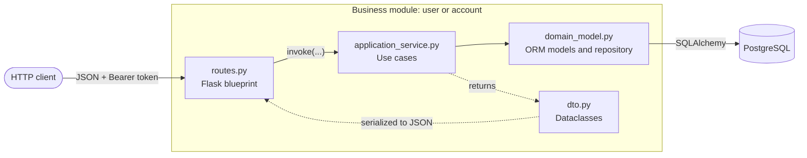
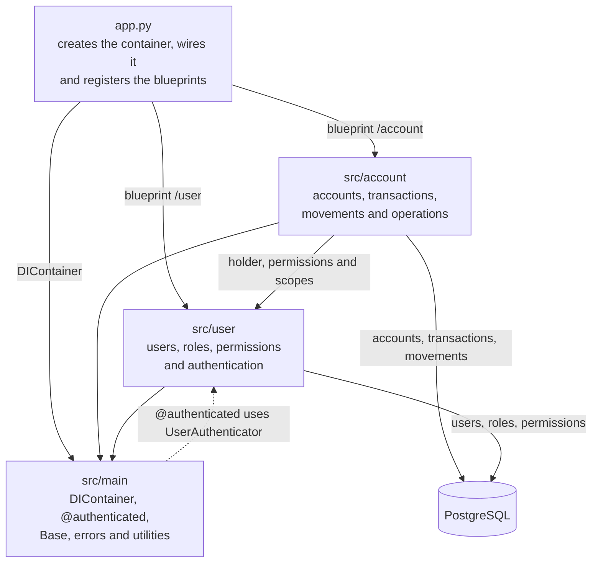

# Banking core

A minimal banking core that records accounts and money movements under the **double-entry bookkeeping rule**, in Mexican pesos (MXN) only. No balance is stored or modified directly: every change happens through balanced movements, and an account's balance is computed from them.

The full specification is in [`banking-core-specification.md`](banking-core-specification.md). The `§N` references in this document point to its sections.

## Contents

- [Features](#features)
- [Stack](#stack)
- [Getting started](#getting-started)
- [Architecture](#architecture)
- [Accounting model](#accounting-model)
- [Users, roles and permissions](#users-roles-and-permissions)
- [Endpoints](#endpoints)
- [Application services](#application-services)
- [Data model](#data-model)
- [Concurrency](#concurrency)
- [End-to-end example](#end-to-end-example)
- [Pending](#pending)
- [License](#license)

## Features

- **Users and access:** JWT login, mandatory password change on first login, authenticated user's profile, admin and operator signup, and user deactivation.
- **Permission-based access control (RBAC):** three fixed roles (`CLIENT`, `OPERATOR`, `ADMIN`), each with permissions of the form *(action, scope)*.
- **Account opening:** client signup with their first account, additional accounts for an existing client, and the bank's own accounts.
- **Operations:** deposit, withdrawal and transfer between accounts of the same bank, each as an atomic double-entry transaction.
- **Reversals:** an admin undoes a deposit, a withdrawal or a transfer with a new transaction that references the original.
- **Balance and history inquiry:** an account's list of movements with the balance each one left, computed in SQL by a view.
- **Accounting invariants:** validated in the domain before persisting any transaction.
- **Safe concurrency:** row locking so two concurrent operations cannot spend the same balance.

## Stack

| Component | Technology |
|---|---|
| Language | Python |
| Web framework | Flask 3.1 |
| ORM | SQLAlchemy 2.1 |
| Database | PostgreSQL 17 in Docker (15+ is required for `UNIQUE NULLS NOT DISTINCT`) |
| Driver | psycopg 3 |
| Authentication | PyJWT (HS256) and bcrypt |
| Dependency injection | dependency-injector |
| Configuration | python-dotenv |

The exact versions are pinned in `requirements.txt`.

## Getting started

```bash
# 1. Environment variables
cp .env.example .env            # and adjust the values

# 2. Dependencies
python -m venv venv
venv/bin/pip install -r requirements.txt

# 3. Database
docker compose up -d

# 4. Schema, roles, permissions and first admin
venv/bin/python create_admin.py

# 5. Development server at http://localhost:8080 (or the PORT port)
venv/bin/python app.py
```

> **`create_admin.py` is destructive:** it drops and recreates every table and the `account_history` view. Today it is the only way to create the schema, because there are no migrations yet.

### Environment variables

| Variable | Use |
|---|---|
| `POSTGRES_USER`, `POSTGRES_PASSWORD`, `POSTGRES_DB`, `POSTGRES_PORT` | `docker-compose.yml` container |
| `DATABASE_URL` | SQLAlchemy connection string (`postgresql+psycopg://...`) |
| `JWT_SECRET` | HS256 signing key |
| `JWT_EXPIRATION_MINUTES` | Access token lifetime, 20 by default |
| `PORT` | Development server port, 8080 by default |
| `BANK_NAME` | Holder shown on NOSTRO accounts |
| `ADMIN_EMAIL`, `ADMIN_PASSWORD` | First admin created by `create_admin.py` |

`.env` is not committed.

## Architecture

The code is organized by **business module**. Each module has four files, one per responsibility, and dependencies point toward the domain:



The modules rely on `src/main`, which is shared, and `account` depends on `user` (holders, permissions and scopes); `user` does not know about `account`. The only dependency in the opposite direction is `@authenticated`, which lives in `src/main` and uses the `UserAuthenticator` from `user`:



```
app.py                       # creates the container, wires it and registers the blueprints
create_admin.py              # schema + RBAC seed + first admin
docker-compose.yml           # PostgreSQL
src/
├── main/                    # shared by every module
│   ├── container.py         # DIContainer: engine, sessions, repositories and services
│   ├── database.py          # SQLAlchemy declarative Base
│   ├── errors.py            # AuthenticationError (401), PermissionDenied (403)
│   ├── middleware.py        # @authenticated decorator
│   ├── routes.py            # GET / and global error handlers
│   └── utils.py             # bcrypt, JWT, bearer_token(), json_body()
├── user/                    # users, roles, permissions and authentication
│   ├── domain_model.py
│   ├── dto.py
│   ├── application_service.py
│   └── routes.py
└── account/                 # accounts, transactions, movements and operations
    ├── domain_model.py
    ├── dto.py
    ├── application_service.py
    └── routes.py
```

| File | Responsibility |
|---|---|
| `routes.py` | Flask blueprint. Reads and validates the shape of the body, calls a service and serializes the response. Holds no business rules. |
| `application_service.py` | Use cases. Each service is a class with a single `invoke(...)` method: it authorizes, coordinates the domain and the repository, and returns a DTO. |
| `domain_model.py` | Enums, ORM models with their rules (movements, invariants, an account's scope) and the module's repository. |
| `dto.py` | Dataclasses passed between routes and services. No ORM model leaves a service. |

> The specification (§3) proposes one folder per layer inside each module. The code uses flat files per module, with the ORM model and its repository together in `domain_model.py`.

### Dependency injection

`DIContainer` (`src/main/container.py`) declares the engine as a `Singleton` and the sessions, repositories and services as `Factory`. Each repository gets its own session. Routes receive the service they need:

```python
@blueprint.route("/<uuid:account_id>/deposit", methods=["POST"])
@authenticated()
@inject
def deposit(
  account_id: UUID,
  actor: AuthenticatedUser,
  account_funder: AccountFunder = Provide[DIContainer.account_funder]
):
  ...
```

### Request lifecycle

1. `@authenticated()` takes the token from the `Authorization` header, validates it with `UserAuthenticator` and passes the user to the route as `actor`.
2. The route reads the body with `json_body()` and checks that the required fields are present.
3. The application service requires the permission, runs the use case and returns a DTO.
4. The route converts the DTO to JSON.

The same lifecycle for a deposit (`POST /account/<account_id>/deposit`):


If the token is not valid, `@authenticated` stops at step 2 with 401. If the permission is missing, the service raises `PermissionDenied` at step 11 and the response is 403; a `ValueError` from the service (invalid amount, nonexistent account) comes out as 400. In those cases nothing is saved and the lock is released when the session closes.

### Errors

Every error is returned as `{"error": "..."}`.

| Code | When | Where it is produced |
|---|---|---|
| 400 | Missing field, invalid amount, nonexistent account, insufficient funds, duplicate alias or email | The route validates the fields and converts the services' `ValueError` |
| 401 | Missing, invalid or expired token; invalid credentials | `AuthenticationError`, global handler |
| 403 | Missing permission, or the user still has to change their password | `PermissionDenied`, global handler |

## Accounting model

### Accounts

There is **a single account type**, with the same rules for all. They differ only by a label:

| Class | What it is | Holder |
|---|---|---|
| `VOSTRO` | A client's account | The client user |
| `NOSTRO` | The bank's own account | The bank (`BANK_NAME`), with no holder user |

Every account carries a required `alias`, unique per holder. Since NOSTRO accounts share a holder, the alias is also unique among them.

### Main side and contra

Each account has two sides in the ledger: the **main** side, which is the balance the holder sees, and the **contra**, which represents the outside of the account. The contra is not another row in `accounts`: it is the `CONTRA` side of that same account's movements, and its balance is always the opposite of the main side's.

```
balance = credits − debits on the MAIN side
```

The main side has a **credit nature**: a credit increases it and a debit decreases it. The contra has the debit nature. That is why a deposit shows up in the account's history as `CREDIT` and a withdrawal as `DEBIT`.

### Operations

Each operation is an atomic transaction: either all of its movements are recorded or none are.

| Operation | Debit | Credit | Movements |
|---|---|---|---|
| **Deposit** to A | Contra A | Main A | 2 |
| **Withdrawal** from A | Main A | Contra A | 2 |
| **Transfer** A → B | Main A | Contra A | 4 |
| | Contra B | Main B | |

A withdrawal and an outgoing transfer leave identical movements in the account's ledger; they are told apart by the transaction's `type` (`DEPOSIT`, `WITHDRAWAL`, `TRANSFER`).

A reversal undoes a transaction with another one of type `REVERSAL`, which repeats its movements with the opposite entry type and references the original. The original is not touched.

Movements are **immutable**: they are never edited or deleted. Their amount is always positive; the direction is given by the entry type (`DEBIT` or `CREDIT`).

### Invariants

`Transaction.validate(balances)` applies them before saving any transaction (§6):

1. **Transaction balance:** the sum of debits equals the sum of credits.
2. **Per-account balance:** in each account, main + contra = 0.
3. **No negative balances:** no main side ends up negative. Withdrawals and transfers without funds are rejected.
4. **Positive amounts:** every movement has an amount greater than zero.
5. **Transfers:** source and destination are different accounts.

### Amounts

They are handled with `Decimal` in the code and `NUMERIC(18,2)` in the database, never with `float`. The API accepts them as text or as a JSON number, greater than zero and with at most 2 decimals, and always returns them as text with 2 decimals (`"100.50"`).

## Users, roles and permissions

### Authentication

- HS256 JWT with a single access token, no refresh and no revocation list. Claims: `sub` (user id), `role`, `iat`, `exp`.
- Sent as `Authorization: Bearer <token>`.
- The user is looked up on every request, so a deactivation or a role change takes effect immediately, without waiting for the token to expire.
- Passwords are stored with bcrypt and allow at most 72 bytes.
- Every new user starts with `must_change_password: true`. While it stays that way, they can only read their profile and change their password; every other route responds 403.
- Login returns the same error on every failure, so as not to reveal which emails exist.

### Authorization

Authorization is done **by permission, never by role**. A permission is the pair *(action, scope)*:

| Actions (`Action`) | `VIEW`, `DEPOSIT`, `WITHDRAW`, `TRANSFER`, `OPEN_ACCOUNT`, `REVERSE`, `MANAGE_USERS` |
|---|---|
| **Scopes** (`Scope`) | `OWN` (the authenticated user's accounts), `VOSTRO` (any client account), `NOSTRO` (the bank's accounts) |

`MANAGE_USERS` has no scope.

To operate an account, the service computes that account's scope relative to the user (`Account.scope_for`) and requires the matching permission:

| Account | Scope |
|---|---|
| NOSTRO | `NOSTRO` |
| VOSTRO held by the authenticated user | `OWN` |
| VOSTRO of another holder | `VOSTRO` |

### Roles

Roles and their permissions are a fixed seed created by `create_admin.py`:

| Permission | Client | Operator | Admin |
|---|:-:|:-:|:-:|
| `VIEW`, `DEPOSIT`, `WITHDRAW`, `TRANSFER` on `OWN` | ✓ | | |
| `VIEW` on `VOSTRO` | | ✓ | ✓ |
| `DEPOSIT`, `WITHDRAW`, `TRANSFER` on `VOSTRO` | | | ✓ |
| `OPEN_ACCOUNT` on `VOSTRO` | | ✓ | ✓ |
| `VIEW`, `DEPOSIT`, `WITHDRAW`, `TRANSFER` on `NOSTRO` | | ✓ | ✓ |
| `OPEN_ACCOUNT` on `NOSTRO` | | ✓ | ✓ |
| `REVERSE` on `VOSTRO` and `NOSTRO` | | | ✓ |
| `MANAGE_USERS` | | | ✓ |

In a transfer the permission is evaluated only on the **source** account; the destination only has to exist. That is why the operator can credit a client account by transferring from a NOSTRO one, even though they cannot deposit to it or withdraw from it.

## Endpoints

Every route receives and returns JSON. Except where marked, they require `Authorization: Bearer <token>`.

### Users

| Method | Route | What it does | Permission |
|---|---|---|---|
| POST | `/user/login` | Logs in | No token |
| GET | `/user/` | Authenticated user's profile | Any user¹ |
| POST | `/user/password` | Changes the password | Any user¹ |
| POST | `/user/admin` | Admin signup (§8.1) | `MANAGE_USERS` |
| POST | `/user/operator` | Operator signup (§8.2) | `MANAGE_USERS` |
| POST | `/user/deactivate` | Deactivates a user (§8.14) | `MANAGE_USERS` |

¹ Available even while the user has a pending password change.

| Route | Body | Response |
|---|---|---|
| `POST /user/login` | `email`, `password` | 200: `token`, `must_change_password` |
| `GET /user/` | — | 200: `id`, `email`, `name`, `role`, `active`, `must_change_password`, `created_at` |
| `POST /user/password` | `current_password`, `new_password` | 200: `must_change_password: false` |
| `POST /user/admin`, `/user/operator` | `email`, `password` | 201: `id`, `email`, `role`, `active`, `must_change_password` |
| `POST /user/deactivate` | `email` | 200: `id`, `email`, `role`, `active: false`, `must_change_password` |

### Accounts

| Method | Route | What it does | Permission |
|---|---|---|---|
| GET | `/account/` | List of every account, NOSTRO and VOSTRO, with its holder and current balance | `VIEW:VOSTRO` and `VIEW:NOSTRO` |
| POST | `/account/client` | Client signup with their first VOSTRO account (§8.3) | `OPEN_ACCOUNT:VOSTRO` |
| POST | `/account/vostro` | Additional VOSTRO account for an existing client (§8.4) | `OPEN_ACCOUNT:VOSTRO` |
| POST | `/account/nostro` | NOSTRO account (§8.13) | `OPEN_ACCOUNT:NOSTRO` |
| POST | `/account/<account_id>/deposit` | Deposit (§8.5, §8.10) | `DEPOSIT` on the account's scope |
| POST | `/account/<account_id>/withdrawal` | Withdrawal (§8.6, §8.11) | `WITHDRAW` on the account's scope |
| POST | `/account/<account_id>/transfer` | Transfer; the account in the path is the source (§8.7, §8.12) | `TRANSFER` on the source's scope |
| GET | `/account/<account_id>/balance` | Movement history with balance (§8.8, §8.9) | `VIEW` on the account's scope |
| POST | `/account/transaction/<transaction_id>/reversal` | Reversal of a transaction (§8.15) | `REVERSE` on the scope of each account of the transaction |

| Route | Body |
|---|---|
| `POST /account/client` | `email`, `password`, `name`, `alias` |
| `POST /account/vostro` | `email` (of the client), `alias` |
| `POST /account/nostro` | `alias` |
| `POST /account/<account_id>/deposit`, `/withdrawal` | `amount` |
| `POST /account/<account_id>/transfer` | `destination_account_id`, `amount` |
| `POST /account/transaction/<transaction_id>/reversal` | — |

**Openings** — respond 201:

```json
{
  "id": "5f0c…",
  "account_class": "VOSTRO",
  "alias": "Savings",
  "holder": "Juan Pérez",
  "holder_id": "9a31…",
  "created_at": "2026-10-10T12:45:24.680332-06:00"
}
```

On a NOSTRO account, `holder` is the bank's name and `holder_id` is null.

**Operations** — respond 201:

```json
{
  "transaction_id": "0115…",
  "type": "TRANSFER",
  "amount": "100.00",
  "account_id": "5f0c…",
  "destination_account_id": "76a4…",
  "balance": "649.50",
  "created_at": "2026-10-10T12:45:24.705659-06:00"
}
```

`balance` is that of `account_id` after the operation. `destination_account_id` is null except in transfers.

**Reversal** — responds 201:

```json
{
  "transaction_id": "c51f…",
  "type": "REVERSAL",
  "original_transaction_id": "0115…",
  "original_type": "TRANSFER",
  "amount": "100.00",
  "accounts": [
    { "account_id": "5f0c…", "balance": "749.50" },
    { "account_id": "76a4…", "balance": "0.00" }
  ],
  "created_at": "2026-10-10T12:50:02.118204-06:00"
}
```

`accounts` lists each account of the original transaction with its balance after the reversal: one for deposits and withdrawals, two for transfers. It responds 400 if the transaction does not exist, was already reversed, is a reversal, or if reversing it would leave an account with a negative balance.

**Balance and history** — responds 200:

```json
{
  "account_id": "5f0c…",
  "account_class": "VOSTRO",
  "alias": "Savings",
  "movements": [
    {
      "movement_id": "19d5…",
      "transaction_id": "9c45…",
      "type": "DEPOSIT",
      "entry_type": "CREDIT",
      "amount": "1000.00",
      "balance": "1000.00",
      "created_at": "2026-10-10T12:45:24.680332-06:00"
    },
    {
      "movement_id": "e96a…",
      "transaction_id": "ddc3…",
      "type": "WITHDRAWAL",
      "entry_type": "DEBIT",
      "amount": "250.50",
      "balance": "749.50",
      "created_at": "2026-10-10T12:45:24.696163-06:00"
    }
  ]
}
```

Movements go from oldest to newest, complete and without pagination. There is no overall balance in the header: the current balance is the last movement's, and an account without movements returns an empty list (zero balance).

`GET /account/` responds 200 with `{"accounts": [...]}`, oldest to newest and without pagination. Each account carries the same fields as an opening (`id`, `account_class`, `alias`, `holder`, `holder_id` and `created_at`) plus `balance`, its current balance as text with 2 decimals (`"0.00"` if it has no movements). It requires `VIEW` on `VOSTRO` and on `NOSTRO`, so only the operator and the admin can see it; a client gets 403.

`GET /` is a test route, without a token, that responds `{"message": "Hello, World!"}`.

## Application services

Each service is a class with a single `invoke(...)` method, registered as a `Factory` in `DIContainer`.

### `user` module

| Service | What it does |
|---|---|
| `UserCreator` | Validates a unique email and an existing role, and saves the user with their password hash. Used by `UserSignup` and `create_admin.py`. |
| `UserSignup` | Requires `MANAGE_USERS` and only accepts the `ADMIN` and `OPERATOR` roles. Clients sign up together with their account. |
| `UserLogin` | Verifies the credentials and that the user is active, and issues the JWT. |
| `UserAuthenticator` | Translates the token into an `AuthenticatedUser` with their id, role and permissions. Used by `@authenticated`. |
| `UserProfileReader` | Returns the authenticated user's profile, without the password hash. |
| `PasswordChanger` | Changes the password and turns off `must_change_password`. |
| `UserDeactivator` | Requires `MANAGE_USERS` and sets `active` to false. Locks the active admins and refuses to deactivate the last one. |

### `account` module

| Service | What it does |
|---|---|
| `ClientSignup` | Creates the `CLIENT` user and their first account in a single commit: both are created or neither is. |
| `VostroAccountOpener` | Opens another account for a client. Rejects a nonexistent email, a user who is not a client or is inactive, and a duplicate alias for that client. |
| `NostroAccountOpener` | Opens a bank account. Rejects a duplicate alias among NOSTRO accounts. |
| `AccountLister` | Requires `VIEW` on `VOSTRO` and on `NOSTRO` and returns every account with its holder and current balance. Locks and modifies nothing. |
| `AccountFunder` | Deposit: locks the account, requires `DEPOSIT`, builds the transaction, validates it and saves it. |
| `AccountWithdrawer` | Withdrawal: same as the deposit, with `WITHDRAW`. Without enough funds, validation rejects it. |
| `AccountTransfer` | Transfer: locks both accounts in id order and requires `TRANSFER` only on the source. |
| `TransactionReverser` | Reversal: locks the original transaction's accounts, requires `REVERSE` on each one and saves a `REVERSAL` transaction with the opposite movements. Rejects a second reversal, the reversal of a reversal, and one that would leave an account negative. |
| `AccountBalanceReader` | Requires `VIEW` and returns the history from the `account_history` view. Locks and modifies nothing. |

There is **one service per operation**, not one per role: the same `AccountFunder` serves the client depositing to their account and the admin depositing to a client's or a bank's account. The difference is resolved by `authorize(actor, action, account)` with the account's scope.

This is how an operation is put together:

```python
amount = parse_amount(amount)                               # validates before opening the DB transaction
accounts = repository.find_by_ids_for_update([account_id])  # SELECT ... FOR UPDATE
authorize(actor, Action.DEPOSIT, account)                   # (action, scope) permission
balance = repository.balance(account.id)                    # main-side credits − debits
transaction = Transaction.deposit(account.id, amount)       # builds the movements
transaction.validate({account.id: balance})                 # invariants
repository.save_transaction(transaction)                    # a single commit, releases the lock
```

## Data model

Primary keys are UUIDs and dates are `timestamptz`.

```
roles ──< role_permissions >── permissions
  │
  └──< users ──< accounts ──< movements >── transactions
```

### RBAC

| Table | Columns | Constraints |
|---|---|---|
| `roles` | `id`, `name`, `description` | `name` unique |
| `permissions` | `id`, `action`, `scope` | `(action, scope)` pair unique. `scope` is null only for `MANAGE_USERS`. `OPEN_ACCOUNT` does not allow `OWN` |
| `role_permissions` | `role_id`, `permission_id` | Composite PK |
| `users` | `id`, `email`, `name`, `password_hash`, `role_id`, `active`, `must_change_password`, `created_at` | `email` unique. Only clients have a `name` |

### Accounting

| Table | Columns | Constraints |
|---|---|---|
| `accounts` | `id`, `account_class`, `alias`, `holder_id`, `created_at` | VOSTRO requires a holder and NOSTRO forbids it. `UNIQUE NULLS NOT DISTINCT (holder_id, alias)` |
| `transactions` | `id`, `type`, `original_transaction_id`, `description`, `created_at` | `original_transaction_id` is unique and only reversals have it |
| `movements` | `id`, `transaction_id`, `account_id`, `side`, `entry_type`, `amount`, `created_at` | `amount > 0`. `created_at` takes `clock_timestamp()` |

No table has a balance column.

### `account_history` view

It has one row per `MAIN`-side movement, with its transaction's type and the account's running balance, computed with a window function:

```sql
CREATE OR REPLACE VIEW account_history AS
SELECT
  m.id AS movement_id,
  m.account_id,
  m.transaction_id,
  t.type,
  m.entry_type,
  m.amount,
  SUM(CASE WHEN m.entry_type = 'CREDIT' THEN m.amount ELSE -m.amount END)
    OVER (PARTITION BY m.account_id ORDER BY m.created_at, m.id) AS balance,
  m.created_at
FROM movements m
JOIN transactions t ON t.id = m.transaction_id
WHERE m.side = 'MAIN'
```

It is defined in `src/account/domain_model.py` and is created and dropped together with the tables. It can also be queried directly from SQL:

```sql
SELECT type, entry_type, amount, balance, created_at
FROM account_history
WHERE account_id = '<account_id>'
ORDER BY created_at, movement_id;
```

## Concurrency

Since the balance is computed from the movements, two concurrent operations on the same account could pass the funds validation at the same time. To prevent it (§10):

- Each operation locks the rows of the involved accounts with `SELECT ... FOR UPDATE` **before** computing balances. The lock is released by the commit.
- A transfer always locks both accounts in the same order, by `id`, to avoid deadlocks.
- `movements.created_at` uses `clock_timestamp()` and not `now()`. `now()` is the time the DB transaction started, before acquiring the lock; with the actual insert time, the history's date order is the order in which the movements were applied.

The balance inquiry locks nothing.

## End-to-end example

With the server running and [`jq`](https://jqlang.github.io/jq/) installed:

```bash
BASE=http://localhost:8080

# Admin login and change of the initial password
TOKEN=$(curl -s -X POST $BASE/user/login \
  -H 'Content-Type: application/json' \
  -d '{"email":"admin@example.com","password":"INITIAL_PASSWORD"}' | jq -r .token)

curl -s -X POST $BASE/user/password \
  -H "Authorization: Bearer $TOKEN" -H 'Content-Type: application/json' \
  -d '{"current_password":"INITIAL_PASSWORD","new_password":"NEW_PASSWORD"}'

# Two clients, each with their account
A=$(curl -s -X POST $BASE/account/client \
  -H "Authorization: Bearer $TOKEN" -H 'Content-Type: application/json' \
  -d '{"email":"juan@example.com","password":"initial123","name":"Juan Pérez","alias":"Savings"}' | jq -r .id)

B=$(curl -s -X POST $BASE/account/client \
  -H "Authorization: Bearer $TOKEN" -H 'Content-Type: application/json' \
  -d '{"email":"maria@example.com","password":"initial123","name":"María López","alias":"Savings"}' | jq -r .id)

# Deposit to the first one and transfer to the second
curl -s -X POST $BASE/account/$A/deposit \
  -H "Authorization: Bearer $TOKEN" -H 'Content-Type: application/json' \
  -d '{"amount":"500.00"}'

curl -s -X POST $BASE/account/$A/transfer \
  -H "Authorization: Bearer $TOKEN" -H 'Content-Type: application/json' \
  -d "{\"destination_account_id\":\"$B\",\"amount\":\"100.00\"}"

# Each account's history: 400.00 in the first, 100.00 in the second
curl -s $BASE/account/$A/balance -H "Authorization: Bearer $TOKEN"
curl -s $BASE/account/$B/balance -H "Authorization: Bearer $TOKEN"
```

## Pending

Still open in §11 of the specification and not implemented:

- Operation idempotency (an idempotency key per request).
- Migrations: `migrations/` is empty and the schema is created with `create_admin.py`.
- Automated tests: `tests/` is empty. A route is verified with `app.test_client()`.

## License

Distributed under the MIT license. The full text is in [`LICENSE`](LICENSE).
